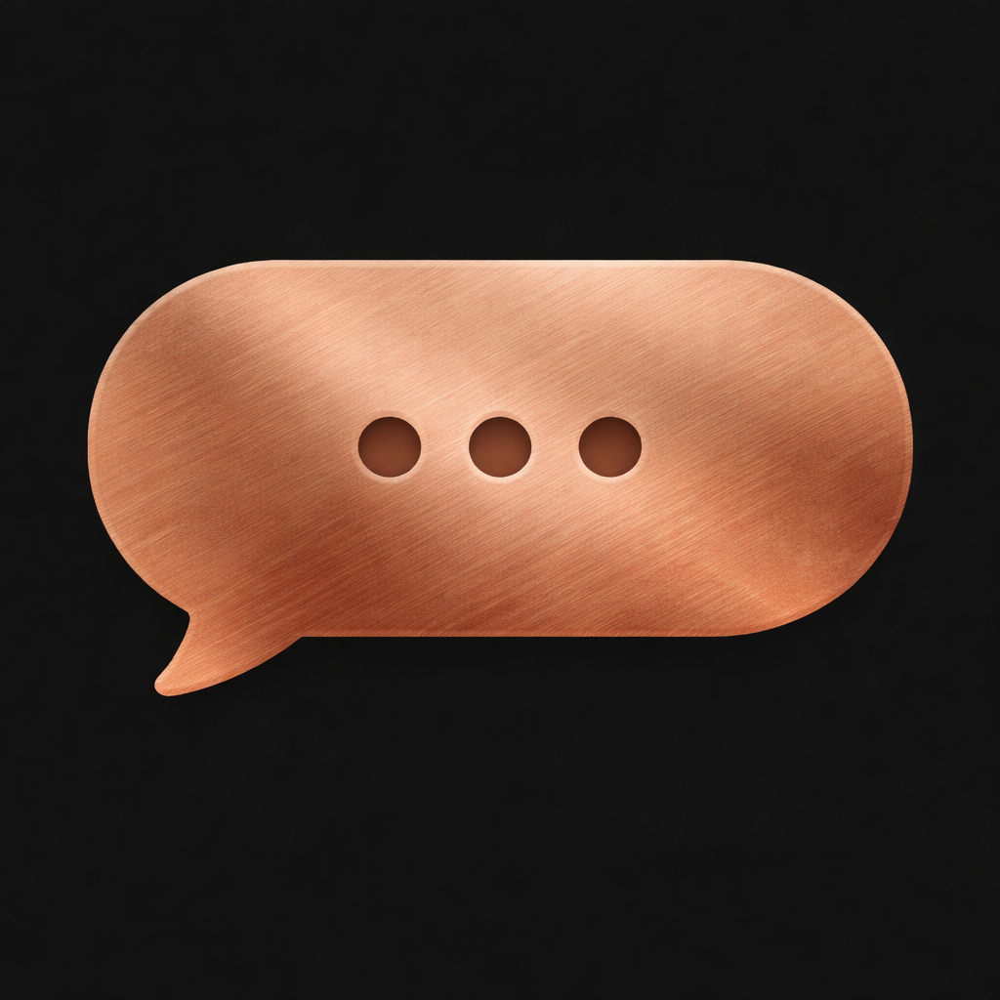

# AiChat for iOS



A SwiftUI chat application source project for on-device text generation, local conversations and voice input. It integrates Apple Foundation Models, MLX and a checksum-pinned llama.cpp runtime.

**Source release; full build and runtime verification are pending.** The preparation host's Xcode license was unaccepted, so an app build, simulator/device run and XCTest execution could not be completed. No binary release is provided. The image above is the author's original app icon, not an interface screenshot; no unverified or simulated UI images are presented.

## Implemented in the source

- Conversation lists, editable titles, message history and local SwiftData persistence.
- A SwiftUI chat interface with Markdown rendering, message actions and attachment handling.
- Apple Foundation Models integration on eligible iOS 26+ devices.
- MLX and llama.cpp provider code for local inference, with model download/storage coordination.
- A release download catalog limited to the verified Apache-2.0 Qwen 3 1.7B and 4B MLX variants.
- Microphone input and Apple Speech transcription, with an explicit on-device audio-file transcription option.
- Model/device capability checks and settings for generation and local storage.

These are source-level capabilities, not a claim of successful runtime certification. Hardware, memory and model availability affect which providers can be used.

## Requirements and setup

- Xcode **26.1 or newer**, with an iOS 26+ SDK and Swift 6 support.
- iOS **18+** deployment target; Foundation Models requires iOS 26+ and a device where Apple makes it available.
- A suitable physical Apple device for meaningful local inference testing; simulator behavior is limited.
- Your own signing team and bundle identifier for device installation.

```bash
git clone https://github.com/andreashxc/aichat-ios.git
cd aichat-ios
open AiChat/AiChat.xcodeproj
```

In Xcode, choose the **AiChat** scheme, set your signing configuration and build for your selected destination. The original author-confirmed app icon is included.

For an unsigned simulator build on a configured Xcode installation:

```bash
xcodebuild \
  -project AiChat/AiChat.xcodeproj \
  -scheme AiChat \
  -configuration Debug \
  -destination 'generic/platform=iOS Simulator' \
  CODE_SIGNING_ALLOWED=NO build
```

Run the **AiChatTests** target in Xcode on a compatible destination. The source-check workflow performs JSON and package checks; it does not claim to build or run the application.

No model weights are included. Select a supported provider after verifying your device and model requirements. Downloads contact their upstream hosts and can be substantial.

## Architecture and runtime provenance

`AiChat/AiChat/Domain/` contains models and services, `Features/` contains the SwiftUI interface, and `Providers/` contains Foundation Models and local-runtime adapters.

The SwiftLlama wrapper is included under MIT at an exact upstream revision. Its unused moving source dependency was removed; the official llama.cpp b5046 XCFramework remains an upstream, checksum-pinned SwiftPM binary dependency. The archive checksum and its eight iOS headers were verified against official sources. Framework bytes are not vendored or released here. See [runtime provenance](third_party/LLAMA_PROVENANCE.md) and [third-party notices](THIRD_PARTY_NOTICES.md).

Documentation: [architecture](AiChat/Docs/ARCHITECTURE.md), [local models](AiChat/Docs/LOCAL_MODELS.md), [persistence](AiChat/Docs/DATA_PERSISTENCE.md), [user guide](AiChat/Docs/USER_GUIDE.md) and [testing notes](AiChat/Docs/TESTING.md). Some inherited design notes describe earlier iterations; this README and [model permissions](MODEL_PERMISSIONS.md) define the public edition's release scope.

## Privacy and model permissions

- Supported text generation runs on-device. There is no configured cloud-provider API key or bundled user conversation data.
- Conversations and attachments are stored locally on the device.
- Model downloads make network requests to the selected upstream repository.
- Live speech recognition and the Base transcription option may use Apple network services. Tiny audio-file transcription requires on-device recognition.
- Prompt and user-message excerpts are not logged; interpolated application log messages use private visibility.

Qwen 2.5 3B, Gemma 2/3 and an unavailable Qwen 3.5 entry are excluded from the offered download catalog. Generic prompt-format compatibility does not grant rights to any model weights. If you distribute weights, retain their actual licenses and notices and comply with their terms; pin and verify the artifacts you distribute. See [MODEL_PERMISSIONS.md](MODEL_PERMISSIONS.md).

## Verification status

All app and vendored Swift source files passed syntax parsing, and the Xcode project passed property-list validation during preparation. The final source and original reachable history passed the local secret scans. Full compilation, linking, unit tests, inference, microphone behavior and device performance remain unverified because of the Xcode license blocker. The official runtime binary was inspected for provenance, not independently rebuilt or executed.

## Author and license

Created by **Andrew Manuilov** ([andreashxc](https://github.com/andreashxc)). The author confirmed the project and original icon are personal work. This is the clean public edition of his original AiChat project.

Original project: [andreashxc/aichat-ios](https://github.com/andreashxc/aichat-ios).

Original work is licensed under [Apache-2.0](LICENSE). Retain the applicable attribution and [NOTICE](NOTICE) when distributing it. Dependencies and downloaded models retain their separate terms; see [AUTHORS](AUTHORS.md), [THIRD_PARTY_NOTICES](THIRD_PARTY_NOTICES.md) and [preparation changes](MODIFICATIONS.md).
